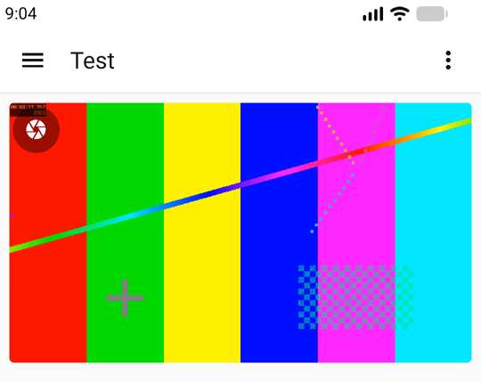

# ha-companion-lab

Measure how Home Assistant frontend code (dashboards, cards, panels) behaves inside the **Home
Assistant Companion app on Android**, without a phone on a cable.

An Android emulator runs the real Companion app, logged in as a limited test user to a throwaway
Home Assistant that the lab starts for you, with a synthetic camera stream and a test dashboard.
Scripts drive the app's WebView over DevTools (Playwright or plain CDP), go to the background and
back, enter fullscreen, pinch, make calls, and measure what the page did and what the screen showed.



## Getting started (Linux with KVM, Docker)

```bash
git clone https://github.com/luukvisser/ha-companion-lab && cd ha-companion-lab
./lab doctor              # checks KVM, Docker, disk, a stray adb server
setup/build-images.sh     # the lab's small tool images
./lab playwright-install  # playwright-core for the Playwright scripts
# Once: read and accept Google's Android SDK licence (nothing is downloaded before that)
docker compose -f docker/compose.yml run --rm -it --entrypoint /lab/setup/accept-sdk-licenses.sh emulator
./lab up                  # the lab's Home Assistant + the emulator; logs the app in the first time
./lab status              # what runs, what the app shows
./lab shot first          # a screenshot to $OUT_DIR/first.png
```

The first `./lab up` downloads a few GB and takes several minutes. `./lab down --all` stops
everything; `./lab help` lists all commands.

## What you can do

| Command | What it does |
|---|---|
| `./lab up [--gpu]` / `down` / `status` | start, stop and inspect the lab (`--gpu`: [faster rendering on a Linux GPU](docs/gpu.md)) |
| `./lab key home\|back\|off\|on\|switcher\|front` | leave the app and come back in different ways |
| `./lab pip on\|off` | picture-in-picture for the app (on: Android's default) |
| `./lab build <card checkout> <name>` | build a card from a checkout (e.g. a pull request's branch) |
| `./lab card <measurement> <builds>` | install card builds into the lab's Home Assistant and measure them: fullscreen, background and return, calls, loading, double tap, ... ([card layer](video/advanced-camera-card/README.md)) |
| `./lab prof cov\|cpu\|mem\|listeners\|instr\|trace` | profile something in the page ([profiling](docs/profiling.md)) |
| `./lab reset-state` | back to the default card build and test dashboard after measurements |
| `echo 'document.title' \| tools/cdp.sh` | run JavaScript in the app's page |

Every result in `$OUT_DIR` comes with a `<name>.meta.json`: the card build and commit, the card's
configuration, the stream, the emulator, app and WebView versions.

## The parts

| Folder | What it is |
|---|---|
| core (`lab`, `setup/`, `tools/`, `docker/`) | the emulator with the Companion app, and the DevTools tools. [How it works](docs/how-it-works.md) |
| [stack/](stack/README.md) | the lab's own Home Assistant: isolated (no internet), with go2rtc, the test stream, the test user, camera and dashboard. Optional Philips Avent add-on |
| [video/](video/README.md) | the synthetic test stream and helpers for camera tests |
| [video/advanced-camera-card/](video/advanced-camera-card/README.md) | card builds and measurements for the Advanced Camera Card: a worked example for other cards |

**Your own Home Assistant instead:** put `HA_URL`, `HA_URL_EMULATOR`, `HA_TOKEN_FILE` and
`TEST_USER_PASSWORD_FILE` in `lab.env` (see [settings](docs/settings.md)), create the limited test
user there (`setup/ha-test-user.sh create`) and start with `./lab up --own-ha`.

**Other machines:** the Docker route needs Linux with KVM. macOS and Windows (WSL2) would use the
host route, which has not been run there: [other machines and the host route](docs/host-route.md).

## Status

- **Works:** the Docker route on Linux, the lab's Home Assistant, WebRTC and HLS video in the app,
  calls to a simulated camera (Avent add-on), the card measurements and profilers. CI runs every
  check and builds the images.
- **Experimental:** GPU rendering ([docs/gpu.md](docs/gpu.md)); the devcontainer route
  ([docs/devcontainer.md](docs/devcontainer.md)).
- **Not covered:** real phones, iOS, Android versions other than 17, macOS and Windows hosts.
- Timings in the emulator are not a phone's. [Pitfalls](docs/pitfalls.md) lists what to watch for.

## More

[Settings](docs/settings.md) · [Pitfalls](docs/pitfalls.md) · [Profiling](docs/profiling.md) ·
[GPU](docs/gpu.md) · [Devcontainer](docs/devcontainer.md) · [Docker route](docker/README.md) ·
[CONTRIBUTING](CONTRIBUTING.md) · [SECURITY](SECURITY.md) · [THIRD_PARTY](THIRD_PARTY.md) ·
[CHANGELOG](CHANGELOG.md)

AI coding agents: [AGENTS.md](AGENTS.md) (also the Claude Code skill in `.claude/skills/`).

## Licence and AI disclosure

BSD-3-Clause ([LICENSE](LICENSE)); third-party components are listed in
[THIRD_PARTY.md](THIRD_PARTY.md) (none is redistributed). Built with Claude Opus 5.5 (Anthropic);
Luuk Visser reviewed and tested it. Careful reviews and runs on other machines are very welcome.
