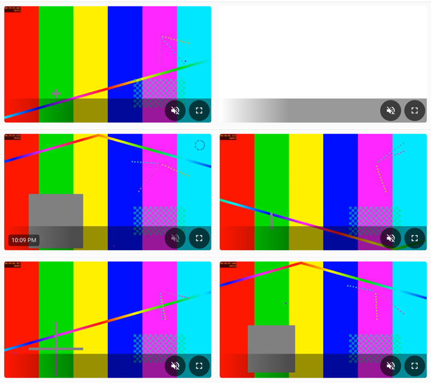

# video/advanced-camera-card/ — card layer (opt-in)

Measurements for the [Advanced Camera Card](https://github.com/dermotduffy/advanced-camera-card)
inside the Companion app, and a way to compare card builds (for example a pull request's branch
against `main`). A worked example: copy its pattern for another card.

## Use

```bash
./lab build ~/advanced-camera-card main        # a build from a checkout into $BUILDS_DIR/main
./lab build ~/advanced-camera-card my-branch   # (a worktree per branch; commit in BUILD-INFO)
./lab card blip main,my-branch 5               # measure both builds, 5 rounds each
./lab reset-state                              # back to the default build and test dashboard
```

`./lab card` installs each build into the lab's Home Assistant, starts the app fresh, runs the
measurement and writes the result with a `.meta.json` (build and commit, the card's configuration,
the stream, emulator, app and WebView versions) to `$OUT_DIR`. To change the test card's
configuration first:

```bash
video/ha-setup.sh dashboard '{"camera_entity":"camera.test_pattern","live_provider":"ha"}'
```

## Measurements

| `./lab card ...` | Measures |
|---|---|
| `blip <builds> [rounds]` | entering and leaving fullscreen: event order, new video elements, mute/pause flips, time without a playing video |
| `blip-interrupt <builds> [rounds]` | Home pressed during the fullscreen transition (`HOME_DELAYS`) |
| `call <builds> [seconds]` | a two-way-audio call, then what the simulated camera received (needs the Avent add-on with `--bridge`; `LAB_MIC=1` feeds the lab tone) |
| `call-cut <builds> [cut s]` | a call while the app's connection to Home Assistant is cut and restored |
| `cov <builds> [rounds]` | calls into the card's functions while entering fullscreen; exact counts |
| `loading <builds> [rounds]` | when the loading indicator appears and fades, first image, first playing video |
| `doubletap <builds> [doubles]` | zoomed in by a `ptz_digital` action, then Chrome's synthesized double taps: back to the default zoom? The gap each time as the page saw it |
| `menu <builds> [rounds] [nav\|bg]` | the menu's buttons on every frame after a return (to the dashboard, or from the background): how often the layout changes |
| `taps <builds> [rounds] [loading\|playing] [targets]` | menu buttons tapped while the media loads: what the tap reached, the action the card ran, fullscreen requests |
| `config <builds> <dashboard.yaml> [camera]` | every camera card in a dashboard file, on the test camera: loads without a configuration error? its menu |
| `mute-cycles <builds> [cycles] [toggle\|back\|swipe\|bg\|switcher\|off]` | the mute state after fullscreen and trips out of the app |
| `bg-rounds\|bg-shots\|bg-video <builds> [rounds]` | app to the background and back (`LEAVE=home\|switcher\|off`): page log, rated screenshots, or a rated screen recording |
| `fullscreen <builds> [rounds] [api\|back\|swipe]` | entering/leaving fullscreen per animation frame |

Every script also accepts the variant `deployed` (the card Home Assistant serves, untouched). The
other Playwright scripts in `playwright/` run with `tools/pwa.sh <path>`.



*The app sent to the background and back, the stream unloaded while hidden: the old picture, a
white card, the stored frame with its time, then live video.*

## Good to know

- **Builds are installed, or served by interception.** With the lab's Home Assistant, `./lab card`
  installs the build. Against your own Home Assistant, the scripts intercept the card's files in the
  app's WebView only (`CARD_PREFIX`) and check afterwards that the page really ran that build.
- **Emulator timings are not a phone's.** Reading a video frame from a canvas costs far more in the
  emulator under software rendering than on phones; frame counts (`BLIP_FRAMES=1`) are only useful
  with `--gpu`. Do not base a performance decision on the emulator alone.
- **Taps and pinches are slow to inject.** Each CDP touch event is a round trip to the emulator: a
  50 ms tap sent as touchStart/touchEnd reached the page as 200-290 ms, its gaps longer by about as
  much (11-11-2026), and a scripted pinch often does not zoom. For anything timed, use Chrome's own
  `Input.synthesizeTapGesture` (`tapCount: 2` for a double tap) and log in the page what it saw.
  Where the zoom is only the starting point, set it with the card's `ptz_digital` action; where the
  pinch itself is under test, use `playwright/pinch.js` (`PINCH=1`) and check that it took.
- **Compare served builds with each other**, not with a deployed card that carries other changes.

Self-tests: `tools/bg_summary.py --self-test` and `tools/rate_frames.py --self-test` (in
`tools/checks.sh`).
